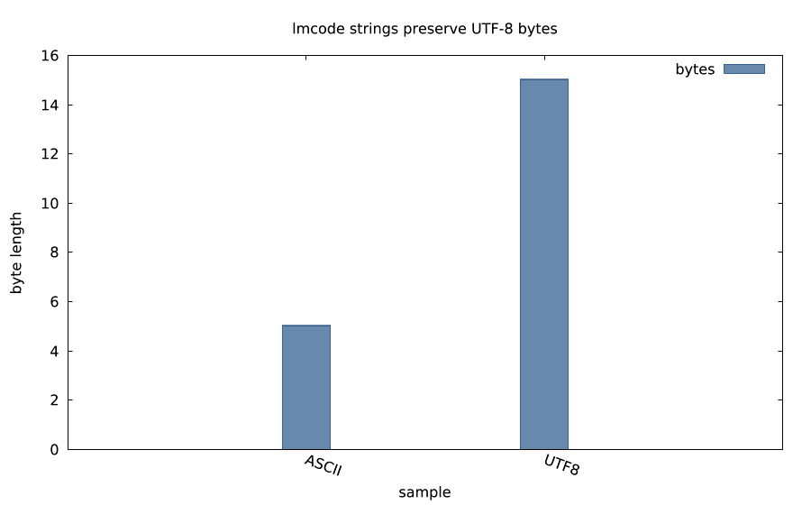
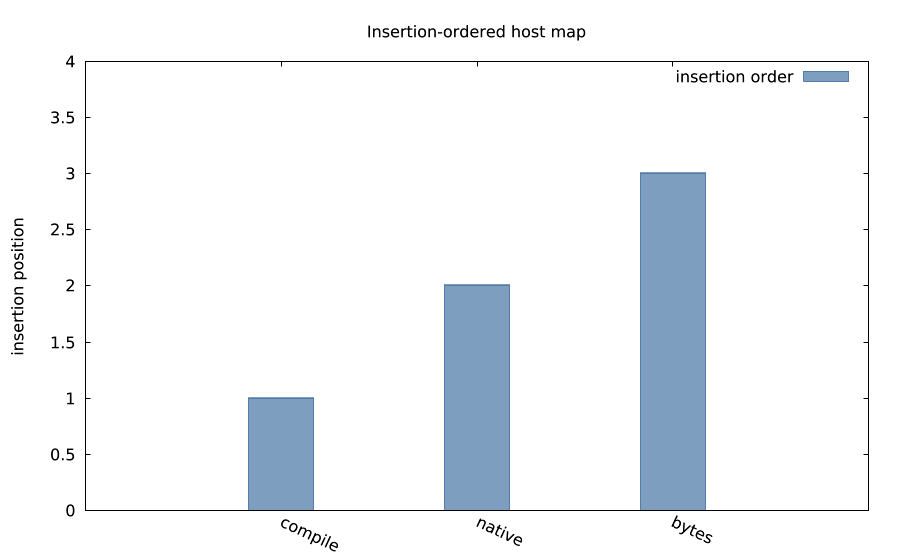
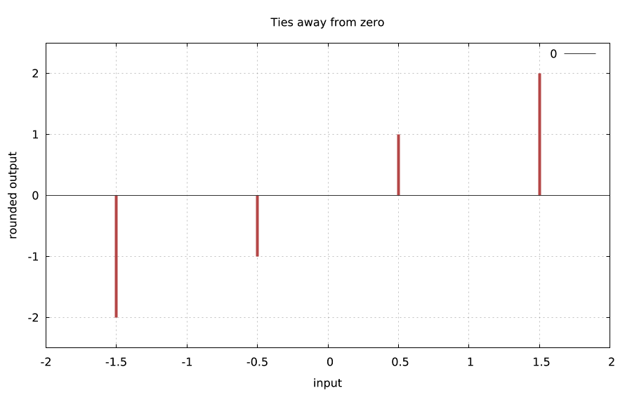
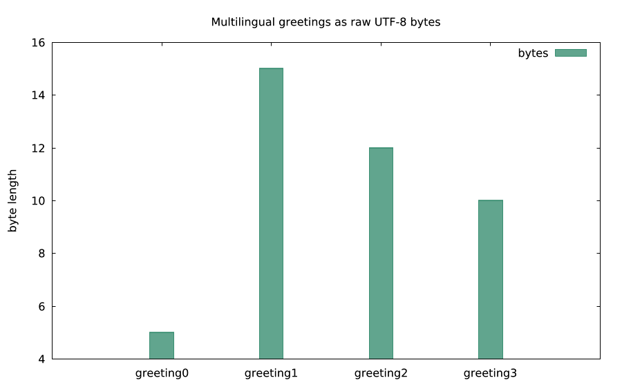
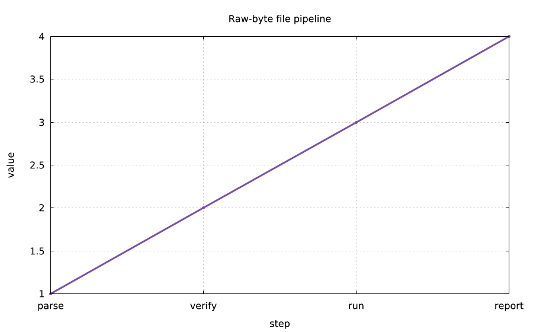
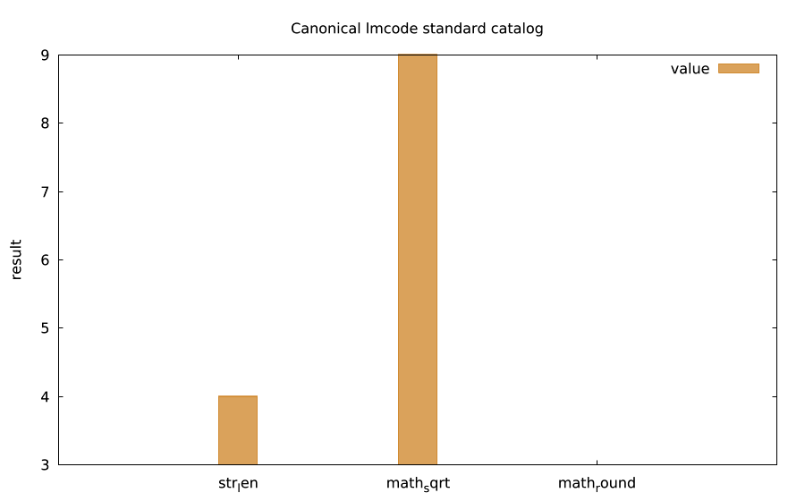

# lmcode-java

Java 21 bytecode SDK: the same program on a JVM or a native executable.

## Install lmctl

Everything in this repository runs through [lmctl](https://lmctl.com), the core tool of the lmctl family. Install it once, then run any `.lms` file or raw URL:

```bash
npm install -g @lmctl-ai/lmctl
lmctl autorun examples/byte_strings.lms
lmctl autorun https://raw.githubusercontent.com/lmctl-ai/lmcode-java/main/examples/byte_strings.lms
```

## Gallery

These self-executing examples write their own CSV inputs and render PNGs through the lmplot host. Run any caption from an empty directory:

| Example | What it shows |
|---|---|
|  | Raw UTF-8 byte lengths — `lmctl autorun https://raw.githubusercontent.com/lmctl-ai/lmcode-java/main/examples/byte_strings.lms` |
|  | Insertion-ordered maps — `lmctl autorun https://raw.githubusercontent.com/lmctl-ai/lmcode-java/main/examples/ordered_map.lms` |
|  | Rounding and int64 wrap — `lmctl autorun https://raw.githubusercontent.com/lmctl-ai/lmcode-java/main/examples/rounding_wrap.lms` |
|  | Multilingual raw bytes — `lmctl autorun https://raw.githubusercontent.com/lmctl-ai/lmcode-java/main/examples/multilingual_greetings.lms` |
|  | Raw-byte CSV file helpers — `lmctl autorun https://raw.githubusercontent.com/lmctl-ai/lmcode-java/main/examples/file_pipeline.lms` |
|  | Canonical math/string catalog — `lmctl autorun https://raw.githubusercontent.com/lmctl-ai/lmcode-java/main/examples/standard_catalog.lms` |

Java 21 SDK and host runtime for lmcode bytecode. It loads the same DSLB format as the lmcode sibling runtimes, verifies imports and stack safety before execution, and exposes a small typed host registry suitable for JVM and GraalVM Native Image builds.

The SDK has no runtime dependencies beyond the JDK. It uses byte strings throughout: `VmString` preserves arbitrary bytes, including invalid UTF-8 and embedded NUL bytes. Standard functions are registered by the default `Registry`; `new Registry(false)` creates an empty host registry.

## Status

Version 0.1.1 implements bytecode v6 only; other bytecode versions are rejected. The current pins include 410 core vectors, 268 standard-library vectors (206 canonical v3 signatures), nine return fixtures, and 19 invocation-envelope goldens. Building native executables requires GraalVM CE 21; running a released native greeter does not require a JVM.

Linux builds target dynamic glibc with a minimum glibc version of 2.35. They do not support musl or alternate libc implementations. Linux C++ runtimes and zlib are static; glibc remains dynamic. Windows native executables use the Microsoft Visual C++ x64 runtime (`VCRUNTIME140.dll` and `VCRUNTIME140_1.dll`).

## Build and test

Requires JDK 21 and Maven 3.6.3 or newer:

```sh
mvn -q verify
```

The project runs unit checks and the shared bytecode and standard-library conformance vectors. To build the example native executable with GraalVM Native Image:

```sh
./scripts/build-native.sh
```

The checked-in CI matrix runs JVM and native conformance on Ubuntu 22.04 x64/arm64, macOS 15 Intel, macOS 14 arm64, and Windows. macOS 13 is retired from the matrix because the official GitHub-hosted macOS 13 image was retired; see the [GitHub Actions runner image retirement notice](https://github.blog/changelog/2025-09-19-github-actions-macos-13-runner-image-is-closing-down/).

## Public API

The public package is `io.lmctl.lmcode`. The main entry points are `Program.load(bytecode, schema, registry)`, `Program.run(context, registry)`, `Registry`, `Context`, `Value`, `VmString`, and `VmException`. `Stdlib.register(registry)` installs the standard catalog explicitly; the default `Registry` installs it automatically.

`Registry.function` and `Registry.method` keep their existing real-callback forms and accept an optional final `Registry.dry(callback)` slot. During a dry invocation, a registration without a slot skips the real callback and returns a fresh dummy of its declared return type; an explicit slot runs once. `Context.dry()` reflects the collector mode. Hosts should set it from `InvocationResults.dry()` before running code. This gates registered callbacks only; it does not sandbox arbitrary host initialization or application code.

The standard catalog (206 signatures) includes byte-oriented string operations, strict RFC 4648 Base64 and hex byte codecs, numeric parsing, math overloads, raw regular-file helpers, insertion-ordered string/int/float maps with independent `keys()`/`values()` snapshots, typed lists, typed stacks/queues/priority queues, immutable strict UTF-8 `Json` (`json_parse`), and optional testing helpers. Standard limits are deliberate: 64 MiB for string results, 2²⁷ glob work steps, 256 JSON container nesting depth, 65,536 collection/document objects per run, a 4 GiB context memory budget, and 10 million VM instructions by default.

## Minimal host

```java
import io.lmctl.lmcode.*;

Registry host = new Registry();
Context context = new Context();
Program program = Program.load(bytecode, schema, host);
program.run(context, host);
```

`Context` exposes configurable instruction and conservative per-run allocation budgets. Host callbacks remain responsible for their own allocations and I/O; this is a trusted-bytecode SDK, not a sandbox.

The Maven artifact is built locally (`mvn install`) or the SDK sources can be vendored; Maven Central publication is not part of this release.

The SDK is MIT licensed. Third-party and toolchain notices are in [THIRD_PARTY_NOTICES](THIRD_PARTY_NOTICES).

## Rule entries (lmcode bytecode (DSLB v6))

Annotated functions with an implements interface produce entries in source order.
Program.entries() returns an immutable List of Program.Entry records with name,
annotation, iface (canonical interface text), params (type names), and returns.
Program.call(index, context, registry, List<Value> args) executes one entry without
requiring run() first. run() still executes only the body. Both use the same interpreter,
registry lifecycle, budgets and source-location handling; each call gets fresh locals.
Argument count mismatch is RUN_HOST: call entry 'NAME' expects N argument(s); found M.
Argument kinds and the returned value are not type-checked; void returns Value.none().
The loader accepts only v6 and verifies each entry's parameter layout, local indexes,
jumps, loop structure and HALT stack depth. No registry interface registration is needed.

The shared `dsl-conformance/3` runner enumerates entries without executing the body;
for call/call_error/call_error_at fixtures it executes the body once before the call.
Core and stdlib pins track the same C++ reference corpus; sample repos migrate separately.

## lmscript tests and annotated interfaces

```sh
npm install -g @lmctl-ai/lmctl
lmctl test.lms
# Equivalent: lmscript test.lms
RUN_NATIVE=1 lmscript --no-preflight test.lms
```

The package installs both executables. Both run `.lms` files; `lmctl` also
accepts URLs ending in `.lms`. Repository tests need the local checkout.
`test.lms` drives Maven's SDK/conformance checks and the native checks when enabled.

[examples/rule-entries/rules.lms](examples/rule-entries/rules.lms) defines an
`@increment` function implementing the schema's `Score(int) -> int` interface.
[RuleEntries.java](src/main/java/io/lmctl/lmcode/examples/RuleEntries.java)
loads it, selects the annotation, calls the entry with 41, and obtains 42.
The test compiles and executes this example. The Java, Kotlin and Scala sample
repositories demonstrate object interfaces and publish tested GraalVM executables.

## Text templates

The standard `template_render(string, Json) -> string` function renders arbitrary text with nested context, indexed lists, loops and boolean conditions. Inserted values remain literal. See the [portable contract and examples](std/template.md).

## Invocation results and envelopes

The native host creates `InvocationResults.fromCommand(parsedFiles)` after parsing
`--lmcode` occurrences. It reads the private `LMCODE_INVOCATION_FILE` descriptor
when present, validates registrations before dispatch, and otherwise uses CLI order
(one occurrence is single mode; repeated filenames retain separate slots).

```java
InvocationResults results = InvocationResults.fromCommand(parsedFiles);
Registry registry = new Registry();
Context context = new Context();
context.setDry(results.dry());
for (var part : results.registrations()) {
    String phase = "load";
    try {
        byte[] schema = schemaFor(part); // authoritative host/role schema
        Program program = Program.load(readProgram(part), schema, registry);
        results.select(part.index(), registry, ResultContract.fromSchema(schema));
        phase = "run";
        program.run(context, registry);
        // Call the host-selected entries using the same part sink.
        results.complete(part.index());
    } catch (VmException error) {
        results.fail(part.index(), phase, error);
        break; // drain already-started work before publishing
    }
}
// Global app validation may call results.fail(null, "app", error).
return results.writeFrame(System.out);
```

There is one fresh owned sink per slot, retained across body and entry calls.
Reselect active slots for interleaving; completion validates, snapshots and seals.
No write, reset, reselection or second completion succeeds after sealing. The
collector retains the first failure and reports its builder slot; global and
single-program failures omit `part`. Results always appear in submitted add order,
independent of dispatch/completion order. The host serializes collector/registry
access and drains its own active tasks.

One terminal UTF-8/LF frame contains either `{"ok":true,"result":PAYLOAD}`, or
`{"ok":true,"result":[PAYLOAD_0,PAYLOAD_1],"parts":2}`. Even one-slot builders have
`parts:1`. Controlled failures contain `ok`, `phase`, `code`, `message`, optional
positive `line`/`column`, and a builder-only `part`; they contain no partial result.
`writeFrame(OutputStream)` flushes without closing, returns 0/2/3/4, and refuses
repeated emission even after output failure. `Reports.failureFrame` handles errors
before collector construction. Sink-only framing and unframed report APIs were
removed; there is no fallback protocol. VM execution never prints implicitly.

Version 1 manifests require a boolean `dry` field. Dry success and failure envelopes
append `"dry":true` after the existing fields; real envelopes omit it. A missing or
nonboolean marker is a CLI failure, never a real-mode fallback. Standalone invocations
without a manifest and embedded collectors created through `fromCommand(files)` are
real; embedded hosts may pass the explicit dry mode overload.

Schema 2 may declare `"result":{"type":"IntMap","nullable":false}`. No declaration
allows any JSON including null; a declared type defaults to nonnullable. Contract
checks are atomic on writes and enforced again on completion. Initial/reset null
is unfinished construction state. Known int-to-float/list/map widening preserves
values; `Json` defers to actual shape; typed collection members are non-null.
The catalog remains v3, 206 signatures, including the same 24 return imports.

Owned copies preserve JSON Pointer failures, strict UTF-8, safe integers and
nonzero-underflow checks. Floats retain **Double.toString** shortest round trips;
`0.1 + 0.2` is **0.30000000000000004**, and negative zero becomes 0. Java receives
launcher-decoded Unicode argv; malformed Java strings and manifest UTF-8 bytes are
refused, while original undecodable OS argv bytes are not recoverable from `String[]`.

`mvn -q verify` runs four pinned corpus families, 19 canonical invocation goldens,
22 malformed descriptor controls, ownership/numeric tests and compiled source
mutations. `RUN_NATIVE=1 ./test.sh` also runs the boundary and goldens in GraalVM
Native Image. The ordinary SDK Greeter uses the new single envelope; external
sample multi-program adapter adoption remains R7.
See [the ownership guide](durable-memory/09-invocation-results.md) and
[canonical standard reference](docs/std.md).

## Historical literal names

The documentation calls the language lmcode. `--lmcode`, `--lmcode-schema` and `--lmcode-signatures` are current host flag literals; `DSLB` is the bytecode magic and `DSLB v6` is the current format name; `.dslb` is the current bytecode filename extension; `dsl.schema` is the current schema JSON key. Other code-formatted API names, paths, manifest names and diagnostic text retain their current literal spellings.
