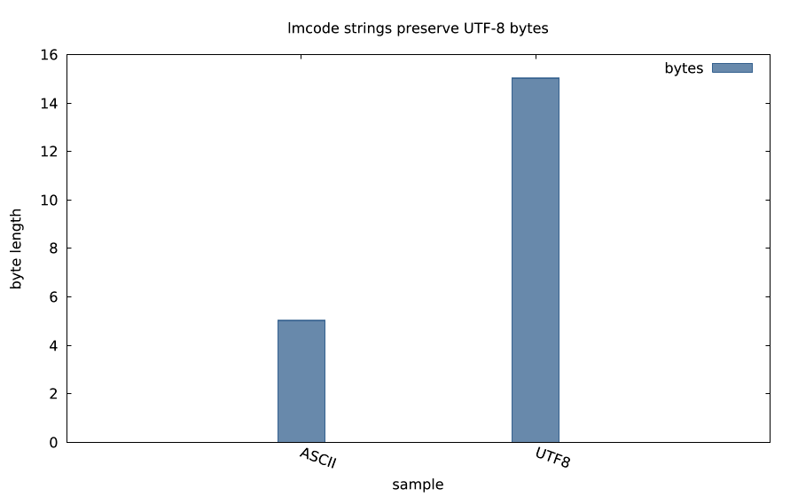
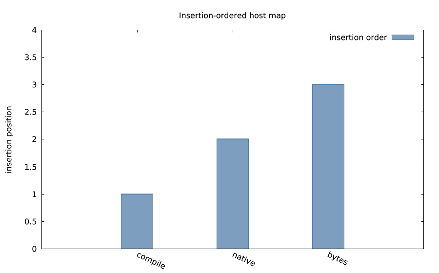
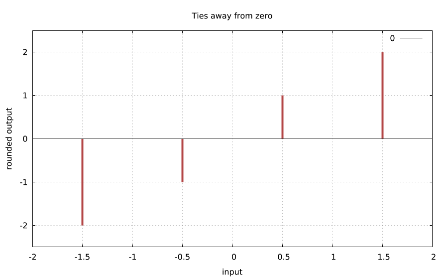
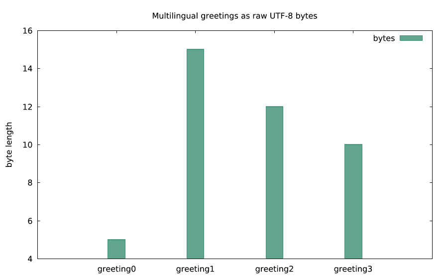
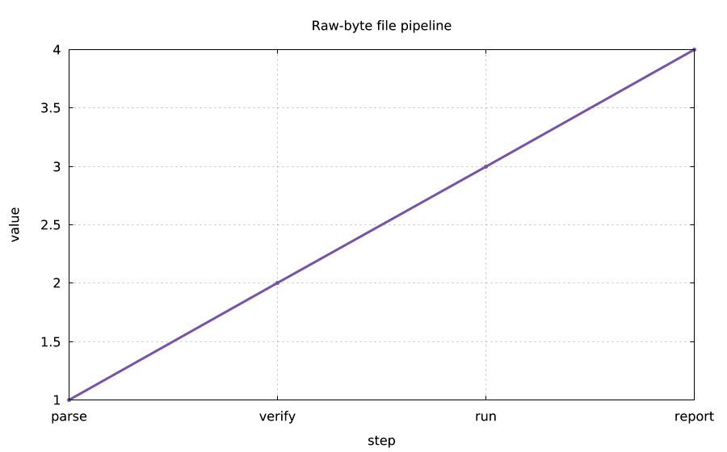
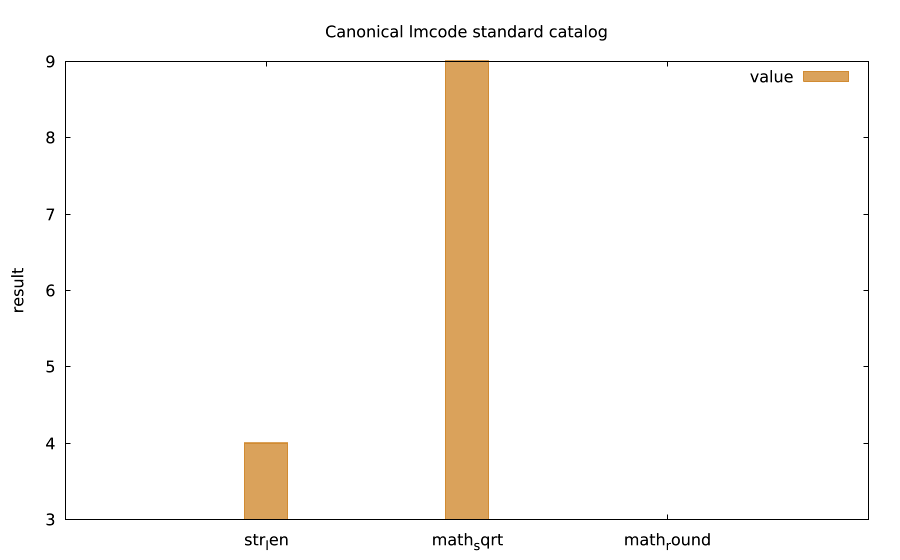

# lmcode-java

Java 21 bytecode SDK: the same program on a JVM or a native executable.

## Gallery

These self-executing examples write their own CSV inputs and render PNGs through the lmplot host. Run any caption from an empty directory:

| Example | What it shows |
|---|---|
|  | Raw UTF-8 byte lengths — `lmctl autorun https://raw.githubusercontent.com/lmctl-ai/lmcode-java/main/examples/byte_strings.lms` |
|  | Insertion-ordered maps — `lmctl autorun https://raw.githubusercontent.com/lmctl-ai/lmcode-java/main/examples/ordered_map.lms` |
|  | Rounding and int64 wrap — `lmctl autorun https://raw.githubusercontent.com/lmctl-ai/lmcode-java/main/examples/rounding_wrap.lms` |
|  | Multilingual raw bytes — `lmctl autorun https://raw.githubusercontent.com/lmctl-ai/lmcode-java/main/examples/multilingual_greetings.lms` |
|  | Raw-byte CSV file helpers — `lmctl autorun https://raw.githubusercontent.com/lmctl-ai/lmcode-java/main/examples/file_pipeline.lms` |
|  | Canonical math/string catalog — `lmctl autorun https://raw.githubusercontent.com/lmctl-ai/lmcode-java/main/examples/standard_catalog.lms` |

Java 21 SDK and host runtime for lmcode bytecode. It loads the same DSLB format as the lmcode sibling runtimes, verifies imports and stack safety before execution, and exposes a small typed host registry suitable for JVM and GraalVM Native Image builds.

The SDK has no runtime dependencies beyond the JDK. It uses byte strings throughout: `VmString` preserves arbitrary bytes, including invalid UTF-8 and embedded NUL bytes. Standard functions are registered by the default `Registry`; `new Registry(false)` creates an empty host registry.

## Status

Version 0.1.1 implements bytecode v5 only; other bytecode versions are rejected. All 51 core and 229 standard-library vectors (171 canonical v2 signatures) run on both JVM and native builds. Building native executables requires GraalVM CE 21; running a released native greeter does not require a JVM.

Linux builds target dynamic glibc with a minimum glibc version of 2.35. They do not support musl or alternate libc implementations. Linux C++ runtimes and zlib are static; glibc remains dynamic. Windows native executables use the Microsoft Visual C++ x64 runtime (`VCRUNTIME140.dll` and `VCRUNTIME140_1.dll`).

## Build and test

Requires JDK 21 and Maven 3.6.3 or newer:

```sh
mvn -q verify
```

The project runs unit checks and the shared bytecode and standard-library conformance vectors. To build the example native executable with GraalVM Native Image:

```sh
./scripts/build-native.sh
```

The checked-in CI matrix runs JVM and native conformance on Ubuntu 22.04 x64/arm64, macOS 15 Intel, macOS 14 arm64, and Windows. macOS 13 is retired from the matrix because the official GitHub-hosted macOS 13 image was retired; see the [GitHub Actions runner image retirement notice](https://github.blog/changelog/2025-09-19-github-actions-macos-13-runner-image-is-closing-down/).

## Public API

The public package is `io.lmctl.lmcode`. The main entry points are `Program.load(bytecode, schema, registry)`, `Program.run(context, registry)`, `Registry`, `Context`, `Value`, `VmString`, and `VmException`. `Stdlib.register(registry)` installs the standard catalog explicitly; the default `Registry` installs it automatically.

The standard catalog (171 signatures) includes byte-oriented string operations, numeric parsing, math overloads, raw regular-file helpers, insertion-ordered string/int/float maps, typed lists, typed stacks/queues/priority queues, immutable strict UTF-8 `Json` (`json_parse`), and optional testing helpers. Standard limits are deliberate: 64 MiB for string results, 2²⁷ glob work steps, 256 JSON container nesting depth, 65,536 collection/document objects per run, a 4 GiB context memory budget, and 10 million VM instructions by default.

## Minimal host

```java
import io.lmctl.lmcode.*;

Registry host = new Registry();
Context context = new Context();
Program program = Program.load(bytecode, schema, host);
program.run(context, host);
```

`Context` exposes configurable instruction and conservative per-run allocation budgets. Host callbacks remain responsible for their own allocations and I/O; this is a trusted-bytecode SDK, not a sandbox.

The Maven artifact is built locally (`mvn install`) or the SDK sources can be vendored; Maven Central publication is not part of this release.

The SDK is MIT licensed. Third-party and toolchain notices are in [THIRD_PARTY_NOTICES](THIRD_PARTY_NOTICES).
